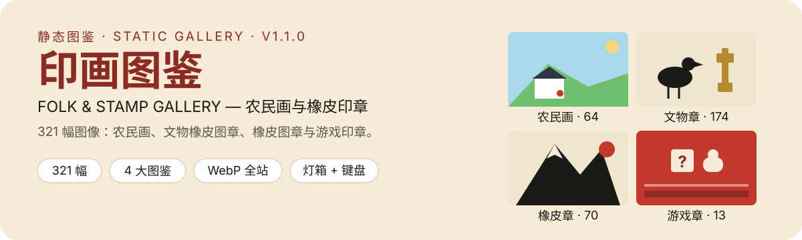
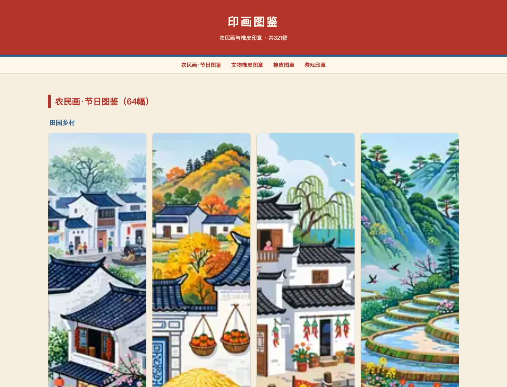
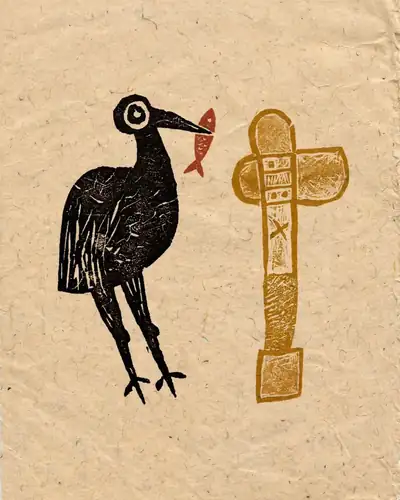
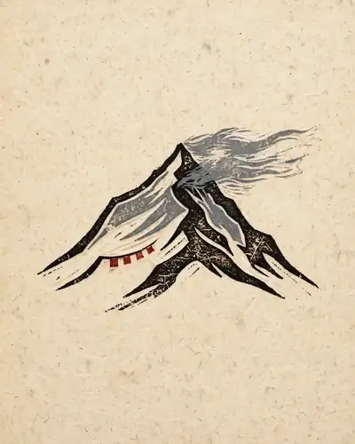

<p align="right"><a href="README.md">中文</a></p>

<p align="center">
  
</p>

<p align="center">
  <a href="https://folk-gallery.xiaosang.cc/">▶ View Online</a>
  ·
  <a href="https://github.com/holynova/folk-gallery">GitHub Repository</a>
</p>

Folk &amp; Stamp Gallery is a static gallery of 321 images: Chinese folk paintings, artifact rubber stamps, rubber stamps, and game-inspired prints. Click any image for the full size; arrow keys flip through them.

## Screenshots

<p align="center">
  
</p>

<p align="center">
  
  
  
</p>

## The Collections

| Collection | Images | Groups |
|---|---|---|
| 农民画·节日图鉴 (Folk Paintings · Festivals) | 64 | 田园乡村 Countryside (4), 中秋国庆 Mid-Autumn &amp; National Day (10), 中外节日·春 Chinese &amp; Foreign Festivals · Spring (10), 中外节日·夏秋冬 · Summer/Autumn/Winter (10), 亚洲节日 Asian Festivals (10), 欧美节日 Western Festivals (10), 世界其他 Rest of the World (10) |
| 文物橡皮图章 (Artifact Rubber Stamps) | 174 | 28 dynasty groups, Neolithic to Ming; 唐 Tang has the most (29), then 北宋 Northern Song (19) and 西汉 Western Han (18) |
| 橡皮图章 (Rubber Stamps) | 70 | 世界名山 World Mountains (10), 中国古建筑 Ancient Chinese Architecture (10), 动物 Animals (15), 世界建筑 World Architecture (12), 山川河流 Mountains &amp; Rivers (13), 原创卡通 Original Cartoons (10) |
| 游戏印章 (Game Prints) | 13 | Game-themed rubber stamps |

Style: folk paintings are bright, flat, decorative, and densely composed; the rubber stamps are abstract and simplified, with bold carved lines in 2–3 mineral colors on a warm Xuan-paper background.

## Browsing

- The grid uses thumbnails (`images/thumbs/`); the lightbox loads full-size images. Images lazy-load, so the first screen only loads what's visible.
- The lightbox supports the keyboard: ← → for previous / next, Esc to close.
- Responsive on mobile: narrow screens tighten the grid and navigation automatically.

## Run Locally

A fully static site — zero build, zero dependencies. Just serve it:

```bash
python3 -m http.server 8080
# Open http://localhost:8080
```

## Tech

- A single `index.html` (~132KB), no framework, no build step; all 321 images are WebP.
- Top navigation anchors jump straight to each of the four collections; every image has a Chinese title (`alt`).

```
index.html              Single-page gallery: 4 collections, 321 images, grid + lightbox
images/                 Full-size images (WebP)
images/thumbs/          Grid thumbnails (WebP)
assets/readme/          README screenshots and samples
```

Current release: v1.1.0.
