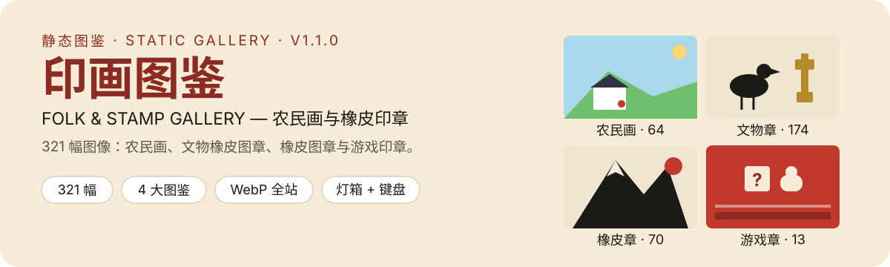
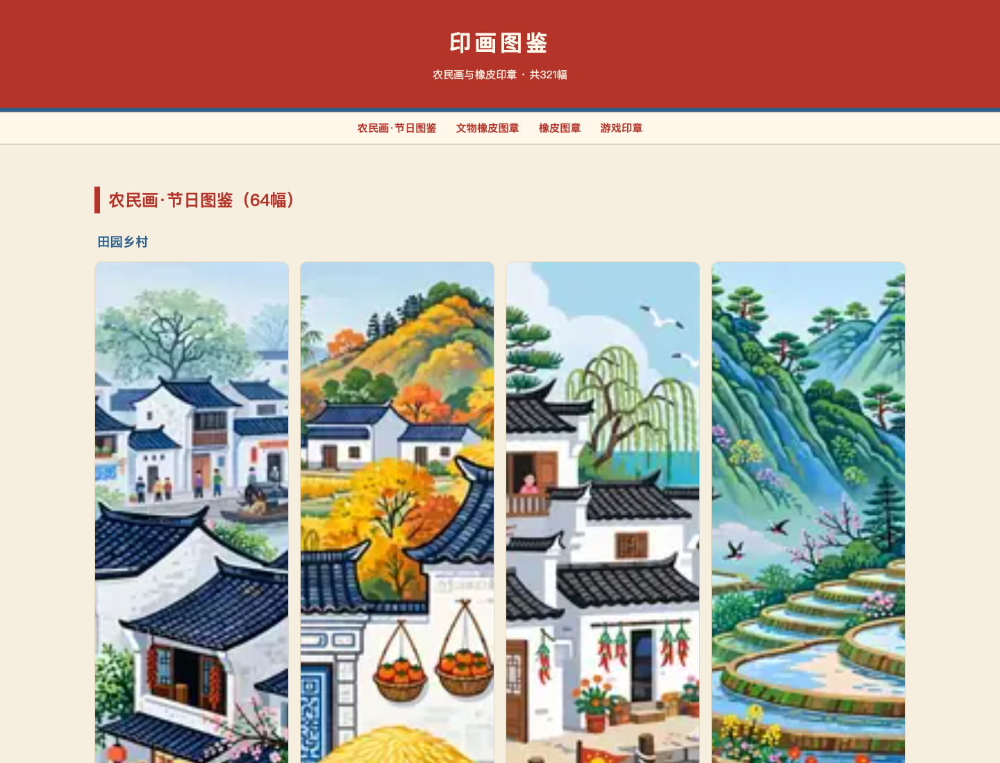

<p align="right"><a href="README.en.md">English</a></p>

<p align="center">
  
</p>

<p align="center">
  <a href="https://folk-gallery.xiaosang.cc/">▶ 在线看图</a>
  ·
  <a href="https://github.com/holynova/folk-gallery">GitHub 仓库</a>
</p>

印画图鉴是一个静态图片站：农民画、文物橡皮图章、橡皮图章与游戏印章，共 321 幅。点任意一幅看大图，键盘可切换。

## 截图

<p align="center">
  
</p>

<p align="center">
  
  
  
</p>

## 图鉴内容

| 图鉴 | 幅数 | 分组 |
|---|---|---|
| 农民画·节日图鉴 | 64 | 田园乡村 4、中秋国庆 10、中外节日·春 10、中外节日·夏秋冬 10、亚洲节日 10、欧美节日 10、世界其他 10 |
| 文物橡皮图章 | 174 | 按朝代分 28 组：新石器时代至明，唐 29 幅最多，北宋 19、西汉 18 |
| 橡皮图章 | 70 | 世界名山 10、中国古建筑 10、动物 15、世界建筑 12、山川河流 13、原创卡通 10 |
| 游戏印章 | 13 | 游戏主题橡皮章 |

风格：农民画色彩鲜亮、平面装饰、构图饱满；橡皮图章抽象简化、粗犷刻线、2–3 种矿物色，印在暖色宣纸底上。

## 浏览

- 网格用缩略图（`images/thumbs/`），灯箱加载全尺寸图；图片懒加载，首屏只加载可见部分。
- 灯箱支持键盘：← → 切换上一幅 / 下一幅，Esc 关闭。
- 移动端响应式：窄屏自动收紧网格与导航。

## 本地运行

纯静态站，零构建、零依赖，起一个静态服务器即可：

```bash
python3 -m http.server 8080
# 打开 http://localhost:8080
```

## 技术

- 单个 `index.html`（约 132KB），无框架、无构建步骤；全部 321 幅图均为 WebP。
- 顶部导航锚点直达四个图鉴；每幅图有中文标题（`alt`）。

```
index.html              单页图鉴：4 类 321 幅，网格 + 灯箱
images/                 全尺寸图（WebP）
images/thumbs/          网格缩略图（WebP）
assets/readme/          README 截图与样张
```

当前发布版 v1.1.0。
